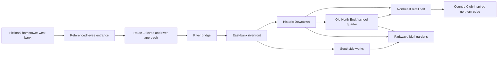

# Hollowtide hometown, levee route and bridge-to-city plan

October 2, 2026, with Preston's later clarification incorporated. The confirmed opening sequence is a fictional Hollowtide hometown inspired by Elwood, then Route 1 beginning at the levee entrance shown in his screenshots, then a river bridge into a fictional city inspired by St. Joseph and its district identities. Elwood, St. Joseph, Missouri River, Lafayette and Country Club are real-world research references, not approved in-game names. This supersedes the older proposal that implicitly began in the east-bank bluff city and treated a western repair-day settlement as the next mandatory destination. The bridge and city maps are not implemented by this document.

## Scale and placement

The current 640×384 Route 1 map is a verified delivery test slice. It does not establish the final size of Route 1 or the whole region. Expansion should give the approach, landing and crossing enough space to feel like different places, with side paths that have a purpose. Do not place the entire city inside the current clearing or merely lengthen an empty path.

Preston has now confirmed the west-bank hometown and travel order; they are no longer merely a planning inference. Use the relationship in his maps: Elwood-inspired hometown west/left, river between, St. Joseph-inspired city east/right. Route 1 begins at the referenced levee entrance after leaving the hometown, follows the river-side approach and connects to the bridge. A levee is a broad raised earth embankment with grassy slopes and a crest track; the existing masonry retaining wall is a separate prop.

**Confirmed opening sequence:** fictional hometown → levee entrance / Route 1 → river bridge → fictional city's riverfront → city sectors.

The hometown, river, bridge, city and sector names remain Hollowtide naming decisions. Do not place the literal reference names on game signs, maps or dialogue. The current prototype's elevated hall and compact dispatch-left/river-right arrangement are existing gameplay staging. Exact entrance alignment, distances, scene boundaries and the hall's final location need a layout review before this becomes the regional map.

The older Highbank/Old Ferry Ward/Far Bank names remain provisional; Highbank is not automatically the hometown's approved name or location. Preserve the useful ideas of a courier service, old landing, missing return mark and two uncertain calls. They do not force the main bridge into a ferry-only design. The ferry landing can coexist with the bridge as an older local crossing, a maintenance stop or a side branch.

## City layout to build toward

Four main district identities follow Preston's direction. Two connecting areas are proposed to make entry and creature exploration work. These are game map units, not official municipal district boundaries or approved fictional names.

| Game area | Regional position/reference | Recognizable art and activity | One possible playable loop |
| --- | --- | --- | --- |
| Riverfront / Bridge Quarter | East end of the crossing, near approaches to the old city | Bridge piers/railings, embankment, older landing, courier arrival board; a clear street climbing inland | Carry a crossing report to the city dispatch branch and return to see the board updated. |
| Southside / Works District | South of the historic core | Active processing/storage works and older industrial buildings; rail, loading yards, patched brick, modest homes and corner shops | Trace a missing delivery across a yard, repair shop and residential block; resolve a particular theft or routing error. |
| Historic Downtown | Central old city above the riverfront | Reused brick storefronts, tall windows, old signs beneath new ones, upper-floor homes, civic square and archive | Deliver a parcel, compare an old route record with a current address, then report to the square's courier board. |
| Old North End / School Quarter | North of downtown; Lafayette and older neighborhood references | School/community building, alumni pride, taverns, porches, brick streets, varied upkeep | Help move or preserve a community display as a building's role changes; speak to people with different memories. |
| Northeast Retail Belt / Country Club Edge | East/northeast Belt corridor, extending toward the separate northern village | Larger stores, forecourts, older enclosed retail beside newer centers, spaced housing and service work | Connect shop deliveries to the older city and show how a rerouted trade path affects both places. |
| Parkway / Bluff Gardens | A green connection through/behind city neighborhoods | Wooded ravines, shaded paths, gardens, overlooks and historic residential slopes | Find a visible habitat clue and carry supplies between neighborhoods using the parkway shortcut. |

The district art direction and proposed loops above are fictional translations of [verified research](../research/st-joseph-city-sectors-2026-10-02.md). Museum Hill/Hall Street/Cathedral Hill residential variety can live inside the downtown, North End and parkway maps; it need not create three extra sectors. Black civic, educational and musical history can inform community spaces and characters throughout the city. Race is not an encounter or crime modifier.

## Connection sketch

This is a compressed game connection graph, not a street map or scale drawing. The bridge carries the player east; subsequent city streets lead north/south/inland.

Do not merge Old North End and Country Club into one homogeneous neighborhood. Country Club is a separate real village; the game can use a district transition or neighboring settlement inspired by that relationship. East Hills belongs to the northeast/east retail corridor, not automatically inside Country Club.

## Character and story texture

Keep the grit Preston remembers alongside work, friendship, school pride, neighborhood repair and everyday services. A named thief, unreliable courier, predatory employer or gang member can have specific actions and motives. Poverty, a school affiliation, Black identity or substance-use problems do not make an NPC hostile by default. People affected by addiction can also be parents, workers, neighbors and people seeking help. Do not copy identifiable real residents into crime plots.

The Lafayette reference is especially useful as a story about continuity after institutional change. The real building serves as a middle school in 2026–27; a fictional school closing, changing use or losing its team can be chosen deliberately. Until that story is chosen, depict a maintained community landmark rather than an abandoned ruin and retain Preston's personal alumni perspective.

Southside's industrial character includes active facilities as well as older or underused ones. Downtown includes repaired occupied buildings and vacancies. Newer retail includes aging buildings and ordinary service work. These overlaps make the city believable and prevent the sectors from becoming four caricatures.

## Next bounded implementation

1. Review the hometown exit and the referenced levee entrance as Route 1's start, with space for a low-field/levee approach, old landing side branch and bridge connection. Preserve the proven delivery interactions and approved art during that review.
2. Establish the west/east banks, bridge footprint and first city street on a simple walkable layout. Keep the river broad enough to read as a crossing, not a decorative ditch; do not lock dimensions until the player-scale view is reviewed.
3. Build only the bridge and a small east-bank arrival loop first. Give the player one useful service/NPC, a district direction board and a return path. Do not create six empty maps or a new quest framework for the entire city.
4. Add a downtown block, then the next district with its own complete activity. Reuse the current perspective, pixel density, materials and foot-based depth while making building silhouettes locally distinct.

The bridge need not be broken or locked as a default story gate. Its connection can be open while the courier assignment gives the player a reason to stop at the landing. Preserve both existing report choices. New city systems, interiors and broader plot reveals remain separate implementation work.

## Status and files

**Designer-directed:** Elwood-inspired fictional hometown on the west bank → Route 1 at the supplied levee-entrance reference → river bridge → St. Joseph-inspired fictional city with differentiated sectors. Real-world names are references only; the game uses Hollowtide names.

**Proposed here:** six game map areas, detailed district connections, character/quest translations and bridge-first build order. The hometown/levee/bridge/city sequence is confirmed by Preston; precise footprints remain proposals. Exact dimensions, gates, chapter timing and final names are not approved by appearing in this file.

**Previously implemented and verified:** complete hall, individual props, tie-offs, empty return-mark holder and delivery loop, documented in [the October 2 review](../art/world/route1-unique-props-2026-10-02/README.md).

**This research pass:** added the verified city-sector research and this plan; added current-direction pointers to the world bible, region atlas, far-bank draft, opening production path, regional synthesis, Route 1 handoff and AI collaboration guide. No runtime scene/script, map dimensions, art, creature data, launch setting or earlier review archive changed. No Gemini run or paid image generation was made. No staging, commit or deletion.

**Later hometown/naming clarification:** this plan and the existing reference/handoff pointers were corrected to distinguish confirmed travel order from real-world source names. No runtime or asset edits were made in this clarification pass.
