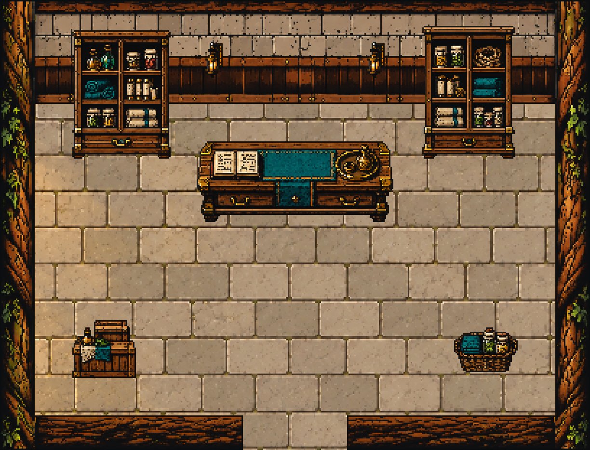

# Storage interior art proposal, October 14, 2026

Task 3's art deliverable is complete and staged for Claude. **This is a proposal, not an installed game room.** The live Storage still opens its existing panel at the door; layout, collision, service/door hooks, panel position and state remain Claude's. No keeper creature or placeholder was added.

The proposed 17×13-tile room is **408×312 native pixels**, at the Hall's existing 24px grid and 3× display scale. Rooted timber, warm limestone, brass, teal cloth and the same 0.75 masked internal detail match the Hall. Two back-wall cabinets contain herb/oil jars, cloth, rope and scroll canisters. A central low counter has a ledger and brass tray; low crates and a basket flank the lower floor. These are decorative supplies, not inventory presets. Courier parcels are absent because the existing service refuses them.

The limestone floor is an exact **1× native crop** from the installed Hall floor, without resampling. Generated walls are cropped/nearest-prepared to the proposed shell boundaries. The generated fixtures have uniform nearest fits into their native canvases; alpha below 224 is removed on copies to exclude soft generated halos, leaving hard native silhouettes with two-pixel canvas margins. All original generation outputs remain intact. Separate finished props keep future foot-based sorting available to Claude.

## Proposed room contract

All rectangles use native pixels, x/y/width/height. `staging/placements.json` is the machine-readable proposal.

| Region/fixture | Proposed rectangle | Notes |
|---|---|---|
| Walking floor | 24,72,360,216 | Floor continues through the south threshold. |
| North wall | 24,0,360,72 | Tall cabinets belong here, facing the viewer. |
| Side walls | 0,0,24,312 and 384,0,24,312 | Root beams; no extra side doors. |
| South wall | 0,288,168,24 and 240,288,168,24 | Three-tile opening at x168..239. |
| Entry/threshold | 168,288,72,24 | Proposed entry tile (8,12). |
| Left/right cabinets | 48,16,72,96 and 288,16,72,96 | Draw depth 112; back-wall stock. |
| Counter | 132,96,144,60 | Depth 156; proposed front approach tile (8,7). |
| Low crates | 48,216,48,48 | Depth 264. |
| Basket | 312,220,48,40 | Depth 260. |
| Back-wall lamps | 140,24,16,32 and 252,24,16,32 | Reused matching lamp asset. |
| Clear aisle | 168,168,72,144 | Three tiles wide, counter approach to threshold. |

Suggested footprints are explicitly provisional and **not installed as solids**. The counter has a five-tile body footprint beneath its top overhang; Claude must confirm it against foot sorting and contact in the game. In the illustrative tile plan, all 108 floor tiles left after those proposed footprints connect to the entry and counter approach. This is not a gameplay collision test.

## Deliverable and preview

Open `staging/project.godot` in Godot 4.7.2 and press F5. It is a standalone art project with its own copied finish dependencies and imported textures; it does not load game saves or the Storage system. Space toggles the shared finish, M shows the mask, Esc closes. The archive's outer `.gdignore` keeps the live game from importing these proposal files.

Use `art/shell.png` with the six `art/props/*.png` assets and supplied placements, or use the assembled `art/storage-raw.png`. Apply the supplied `art/detail-mask.png` with the existing Hall's shared 0.75 shader once. Do not add the separate props to the assembled background a second time. `review/finished-native.png` is a baked reference; do not apply the shader again if using it as a flat finished image. Separate assets are preferred for Claude's final sorting/integration.

The existing Storage panel is unchanged: `Rect2(166,64,820,160+40*max(1,rows.size()))`. Unlock, bag/stored record, parcel refusal, controls and loss rules remain untouched. The room/door hook is Claude's pending integration, exactly as the current task requests. No message was sent to another chat.

## Verification

- Native Godot compatibility preview **8/8**, plus **8/8 after packaging**: native dimensions, exact 3× viewport, real Space/M key toggles, unshaded RGBA exact, shared 0.75 detail active, zero changed unselected floor pixels, and return from mask to finished art.
- Six props: exact native sizes, binary alpha, two-pixel margins, CPU sel-out alpha preserved and **zero changed interior pixels**. The one-pixel material rim is the only CPU colour change.
- Original Hall floor crop byte-exact; center aisle and threshold retain that exact floor and zero detail-mask selection. All 108 proposed walkable tiles connect; no solids installed.
- **539 protected existing game sources/current Parcel-water files exact.** No live game scripts, art, settings, data, saves, collision, other proposal art or training process changed. No commit. Only this new proposal archive and three current status documents are written to the live repo.
- Final packaged native log is clean apart from the existing Windows certificate-store diagnostic. The first import caught a standalone preview variable named `material`, which conflicts with Node2D's inherited property; renamed to `finish_material` before the passing preview. The earlier source preview's direct Image reads produced editor export warnings; the final checker uses absolute project paths. These tooling attempts are retained, not hidden.

`verification.json`, `review/native-checks.json`, `review-packaged/native-checks.json`, originals/reference snapshots, exact preparation recipe, source hashes and all prompts accompany the assets. No full game Storage integration or exported-build test is claimed.

## Generation and provenance

Used the [imagegen skill](C:/Users/pmcga/.codex/skills/.system/imagegen/SKILL.md), built-in tool, **two calls**: (1) an empty shell from the native layout guide with current Hall style references; (2) six isolated fixtures from a transparent guide with the same references. Exact prompts: `shell-prompt.txt` and `props-prompt.txt`. Original tool outputs: `generation/shell.png`, `generation/props.png`; original default files are also retained under Codex generated_images. No external paid generator/API was used. Exact model/version was not returned by the tool.

This is **AI-generated room/fixture art with AI-assisted native preparation and code finish**, combined with reused existing AI-generated Hall flooring. It is not human-drawn artwork. The generated shell's floor and accidental side-wall openings are not used: the native assembly reuses the exact Hall floor and crops plain root-beam segments to preserve the proposed single south opening. `native-preparation.json` records every source crop, alpha threshold, uniform fixture fit and native placement. Source images and existing Hall assets are never overwritten.

**Next for Codex:** task 4, the shared dialogue frame's corner under the portrait. Tasks 1-3 deliverables complete; tasks 4-5 remain pending. Claude's Storage room integration remains separate.

