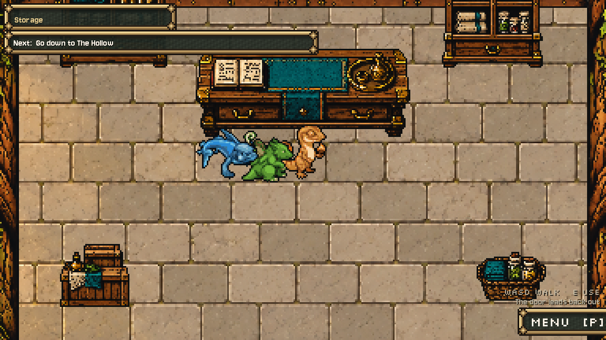

# Storage interior installed, October14,2026

The existing route-unlocked Storage now has a real room: enter its town door after Rootbank Warren, walk to the counter and press E. W/S selects, E puts one in, R takes one out, Escape closes. Walk through any of the three south threshold tiles to return beside the Storage door. No keeper or placeholder creature.

The native17x13/408x312 room uses the staged Hall-style shell and six finished props. All seven copied source PNGs are byte-exact; a new shell-only mask avoids applying prop detail to the floor. CPU rim is already baked into those copies; the shared0.75 shader is applied once. Seven separately drawn instances sort by their front-foot depths: cabinets112, counter156, crates264, basket260, lamps56. The imagegen originals and exact prompts remain untouched in [the original proposal](../storage-art-proposal-2026-10-14/README.md); this integration made no generator calls. It retains AI-generated art provenance, with AI-assisted native preparation and code hooks; exact image model unknown.

The room starts floor at row3, blocks the five proposed furniture bodies, keeps the three-tile central aisle, and opens all three exit tiles. All108 open tiles connect. The team uses the existing town creature size, footsteps/movement and foot sorting. Other rooms retain their original floor/exit defaults. `storage_room_art.gd` handles only art, `storage_panel.gd` shares the old panel/control bodies between hosts. Existing `Storage.open/rows/move`, unlock, parcel refusal, ten-kind cap, loss rules and TeamState save format are unchanged. The panel keeps its166,64 origin and current row layout.

Moving the service indoors needed one pause-menu condition: Storage now calls the same `_record`/`autosave` path as Highbank on Return to title or Quit. Without it, a player could leave the new room before town arrival saved the last deposit. The actual pause Return to title and title Continue were verified with a private save; no new save format or suspend rule.

## Verification

**53/53 staging and53/53 installed live assertions:** updated production Storage11, actual room/keyboard route20, real pause/Continue5, Home/Hall4, Hall-floor links/NPC13. `stage-audit.json`/`live-audit.json` name the exact selected logs and diagnostics. `live/integration/` contains entry, counter panel, behind/front sorting and town-return captures. The three-member party spawns on distinct open tiles; actual E/R/W/S/Escape and walked left exit work, and the right exit is checked too. Actual automatic town-arrival save and pause/Continue restore stored counts.

All five final native suites have clean logs. An earlier Hall run reported a shutdown warning for2 ObjectDB instances/1 resource still in use; the final staged and live native runs with private persistent-music teardown are clean. One staged native Hall window exited before producing assertions; its incomplete log was not counted. The headless Hall attempt passed its assertions but emitted existing shader-helper compilation diagnostics; it is not the visual verification. The final clean native Hall log is selected explicitly by the audit; earlier diagnostics remain archived as separate attempts.

Early attempts are preserved: missing explicit Dictionary type in the extracted helper; copied UI sound function needed its `last_sfx` field; route fixture initially omitted `TeamState.give_to` for its third party member and looked up a prop by a float-formatted node name; Continue fixture initially pressed before title boot completed. Fixed before the final passing runs. The production service check now uses its own save path from the beginning and frees its owned persistent music at teardown. Native runs use isolated APPDATA/LOCALAPPDATA, Dummy audio, fixed30fps and own only their subprocess; no real save or user editor/training process was touched.

Four existing files change: `hub_town.gd`, `town_room.gd`, one condition in `game_pause_menu.gd`, and `tools/debug/storage_check.gd`. Two new helpers, eight native PNGs and native import metadata/cache installed. All1087 other protected existing source/data/dialogue/UI files exact; prior Parcel Board hook, water finish, shared dialogue correction, Storage rules, creature/rule/state files and Claude's other proposals preserved. See `originals/`, `changes.diff`, `prepared/` and hash receipts. No commit or export-package test.

## Play and reproduce

F5 the live game; after the Warren road is clear, use the Storage building's door and walk north to the counter. Existing saves need no migration. Generic `town_room.tscn` still defaults to Home when run alone; enter Storage through town to use its room id.

Work folder `D:/dev/hollowtide-storage-integration-20261014`; stage `D:/dev/hollowtide-world-refinement-20261008/project`. `run.py integration --live`, `run.py storage_check --live`, `run.py quit_check --live`, `run.py town_room_check --live`, `run.py hall_floors_check --live` reproduce checks; omit --live for stage. Drivers retain their original work output paths, with separate profiles and archived prior logs. `prepare.py`/`install.py` record and guard pre-install originals; do not rerun them blindly against an installed/changed checkout. `native-imports/` records eight lossless/no-mipmap imports from a minimal project, without a full game editor scan. No new image-generation skill needed: existing finished PNGs were copied exactly.

**Remaining development-tool limitation:** the historical Claude-owned `record_pitch_v3.gd` Storage segment still expects the outside-door panel and keeps a reference to that town scene. It needs an adapted room/counter shot before recording again. The old v3 MP4s/GIFs remain valid historical captures; no v3 tool or footage was overwritten, per the queue's preservation rule. A new capture should use a new version and include the current Parcel, water, dialogue and Storage visuals.

All October14 queue deliverables and both follow-up integrations are complete. Original proposal archives are preserved with their earlier pending wording; current start-here and inventory supersede those statuses. No message to another chat or new paid call. Preston's visual review remains his.

