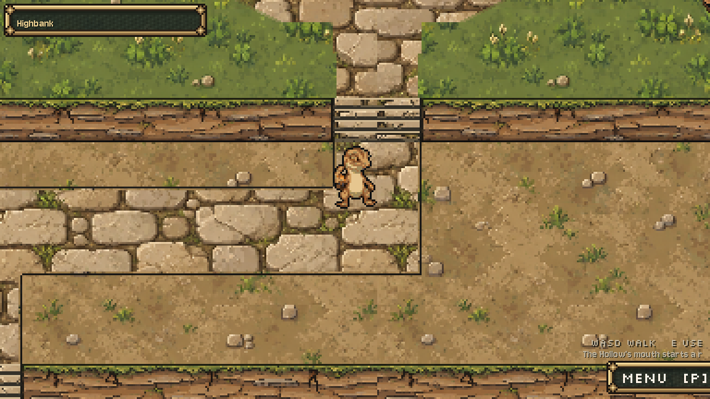

# Highbank world sel-out, 2026-10-11

Preston requested world sel-out after the rebuilt Hall interiors, followed by a compact new-Codex-chat handoff.

Installed the remaining structural terrain finish: material-colored one-pixel rims on connected lane borders, exposed cliff lips/faces and stair channels, plus bounded shared internal ink on cliff faces and switchback treads. Top-left edge light follows the existing `scripts/art/selout.gd` preset. Road selection follows the union of the actual PATHS, so intersections have no per-tile outlines. Grass, clay and stone walking interiors remain quiet. Existing landmark art, foundations, contact shadows, approach fans and their one-tile margins are protected. The finished river bank, water and glints remain exact.

Runtime scope: one return hook in `scripts/town/highbank_painter.gd`, one map-material hook in `scripts/town/hub_town.gd`, new `scripts/town/world_finish.gd`. Original PNGs and source palettes unchanged; no regeneration or imagegen call. No layout, path, door, movement, service, story, save, creature, interior, shared shader or project settings edits. The helper returns other-sized pictures untouched. This is a visual proposal for Preston's review.

## Evidence

- Native Godot4.7.2/OpenGL artwork checks21/21 staging and live.7753 raw material-edge pixels changed;26520 additional pixels received selected GPU detail. Zero changes outside the terrain mask; dimensions and alpha exact. All13 landmarks including their one-tile margins compare pixel-exact against the before map; the entire river strip also compares exact. Actual town scene has one masked material on the map; its walking grid remains exact.
- Current hub check: all13 doors reachable, no building overlap, ferry reachable,12/12 E services answer, actual Hollow entry works, leader/partner follow each other.
- Current walking check: Kithflare and Tallowroot each show8 walking pictures and return to their stills.
- Both Hall door tiles are walkable, align with the two-tile steps and answer as the Hall.
- Current dungeon regression5/5 assertions pass, including both rival moves, Hollow styles/Warden pond scene and town dungeon selection. This pass does not edit dungeon runtime.

`before.png` is the original full raw map; `after_raw.png` includes CPU rims; `after.png` is the full native GPU output. Actual same-position creature scenes: `before_lane/after_lane`, `before_switchback/after_switchback`, `before_landing/after_landing`. `detail_mask.png` shows selected terrain geometry. `originals/`, `presentation.diff`, installed hashes and preservation audit retain the precise source scope.

Private debug drivers redirect captures to D: and free persistent Music on teardown. Native staging copies include Claude's new Dialogue Manager addon/configuration. A pre-existing third-party test_scene UID warning falls back to its correct text path and appears in the before and after runs; no addon source was edited. A staging editor import stalled at autoload creation and was stopped by its exact staging-only command line; native current-project checks ran correctly. No live editor or Claude process was stopped.

User requested a fresh-chat handoff to save usage: `docs/team/CODEX_START_HERE_2026-10-11.md`. Claude remains active in other code. Preserve his new Dialogue Manager flood talk, revised boss staging, creature generation and current dirty work. No commit, reset, stash or revert.

